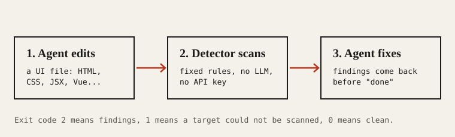

# Anti-AI Design

A design skill for AI coding agents, plus a detector that catches the habits that make generated interfaces look alike.



Ask a model for a landing page and you tend to get the same one: Inter everywhere, a purple-to-blue gradient, cards inside cards, a colored stripe down the side of each card, gray text on a tinted panel. Anti-AI Design gives your agent two things to work against that:

- **A skill.** 24 commands (`critique`, `audit`, `polish`, `bolder`, `quieter`, `harden`, and more) that load a focused playbook for one kind of design work, so "make it better" turns into a named move aimed at one target.
- **A detector.** A command-line engine with a fixed set of rules for AI-generated tells and for plain quality problems (tiny text, cramped padding, skipped headings, low contrast). It needs no model and no API key, and gives the same answer every run.

## Status

Pre-release. Nothing is published yet: the npm package, the engine release downloads and the plugin listings do not exist, so `npx anti-ai-design` will not resolve until the first release. Until then, build the engine from source (see [Install](#install)).

Some features call a hosted service that this fork does not have yet. The `help` subcommand fetches its command list from one, and so does the visual-direction catalog used when a new design starts. Those fail with a network message rather than working offline. The detector, `install`, `update`, `check`, `link` and `ignores` do not need it.

## Fork notice

Anti-AI Design is a modified fork of [Impeccable](https://github.com/pbakaus/impeccable) by Paul Bakaus, taken at upstream commit `c8891a9ae865d6ee311836ae5199bfce0fe115b1` (package version 4.8.0) and used under the Apache License 2.0. It is not affiliated with or endorsed by the upstream authors. What we copied, what we changed and where changes are recorded is in [UPSTREAM.md](UPSTREAM.md) and [NOTICE.md](NOTICE.md). Upstream itself started from Anthropic's [frontend-design](https://github.com/anthropics/skills/tree/main/skills/frontend-design) skill.

## How it differs from a generic linter

A general-purpose CSS or HTML linter asks whether your code is valid and follows a style guide. Anti-AI Design asks whether the result looks generated.

- **It targets design habits, not syntax.** Rules are sorted into `slop` (patterns that repeat across AI output, such as gradient text or a thick accent border on one side of a card) and `quality` (problems that hurt anyone, such as low contrast or tiny text). Some rules are advisory: they are listed separately and never change the exit code.
- **It can look at the rendered page.** Source files get pattern rules only. Rules that need computed styles, such as contrast, run when you scan a URL or a running desktop app, using a Chrome or Edge you already have.
- **It runs inside the agent's loop.** Where a harness supports hooks, the installer adds one that scans each UI file the agent edits and returns the findings before the agent calls the work done.
- **It reads your project's context.** `PRODUCT.md` and `DESIGN.md` in your repo tell the skill who the product is for and what the visual system already is, so a fix stays on-brand. `--no-design-system` turns that off for a scan.
- **It has rules of our own.** Besides the rules inherited from upstream, the engine carries `aad-` rules written for this project. `detect --list-rules` prints every rule with its id and description.

The detector is not a replacement for a design review. It catches known patterns; whether the design is good is still a judgment, which is what the skill's `critique` command is for.

## Install

Once the first release is out:

```bash
npx anti-ai-design install
```

The installer detects your coding tools, asks whether to install for this project or globally, and offers the design hook where the tool supports one. Then reload your tool and run `/anti-ai-design init` in your agent (`$anti-ai-design init` on Codex).

Options, all from `install --help`:

```bash
npx anti-ai-design install -y --providers=claude,codex --scope=project   # no prompts
npx anti-ai-design install --no-hooks                                    # skills only
npx anti-ai-design install --force                                       # replace an existing install
npx anti-ai-design update                                                # refresh an existing install
npx anti-ai-design check                                                 # are installed skills up to date?
npx anti-ai-design link --source=vendor/anti-ai-design --providers=claude,cursor   # link a checkout or submodule
```

### Build from source (works today)

You need a Rust toolchain.

```bash
git clone https://github.com/Choxie77/anti-ai-design
cd anti-ai-design/anti-design-skill
cargo build --release -p anti-ai-design
export ANTI_AI_DESIGN_BIN="$PWD/target/release/anti-ai-design"
target/release/anti-ai-design --version
```

The binary is a single static executable. Setting `ANTI_AI_DESIGN_BIN` tells the npm launcher and the installed skill to use your build instead of downloading one.

### Supported tools

The installer can write skill folders for these harnesses: Claude Code, Cursor, Codex CLI, Replit Agent, GitHub Copilot, Gemini CLI, Google Antigravity, Devin, OpenCode, Grok Build, Kiro, Trae (and Trae China), Qoder, Rovo Dev, Mistral Vibe, Pi, Hermes Agent, and DeepSeek Harness. We have not tested each one end to end; the per-tool layout is described in [docs/HARNESSES.md](docs/HARNESSES.md). The design hook is not available for every tool, and a few need a manual trust step before it runs.

## Use it in your agent

Run `/anti-ai-design init` once per project. It reads your code, asks only what it cannot infer, and writes `PRODUCT.md`. Later commands read it. Run `/anti-ai-design document` to record an existing visual system in `DESIGN.md`.

Then name a command and a target:

```
/anti-ai-design critique the onboarding flow
/anti-ai-design quieter the landing page
/anti-ai-design polish settings
/anti-ai-design harden checkout
```

You can also describe the job in plain words. Narrow targets work better: one section reviewed closely beats a whole page at a glance.

### The 24 commands

| Group | Commands |
|---|---|
| **Build** | `shape` plans the UX before code · `init` writes `PRODUCT.md` · `document` writes `DESIGN.md` · `extract` pulls repeated patterns into shared tokens and components · `craft` (deprecated alias for an ordinary build request) |
| **Evaluate** | `critique` is a scored UX review · `audit` checks accessibility, performance and responsive behavior |
| **Refine** | `polish` is the last pass before shipping · `bolder` · `quieter` · `distill` removes what the page does not need · `harden` covers errors, i18n and edge cases · `onboard` designs first-run flows and empty states |
| **Enhance** | `animate` · `colorize` · `typeset` · `layout` · `delight` · `overdrive` |
| **Fix** | `clarify` rewrites unclear copy · `adapt` handles screen sizes and devices · `optimize` fixes loading and rendering |
| **Iterate** | `live` picks an element in the browser and cycles variants · `generate` produces variants of a named element |

Type the command name alone to see a context-aware menu. `pin <command>` creates a standalone shortcut for one you use often.

### Live mode

`/anti-ai-design live` opens your running dev server with an overlay: pick an element, choose a direction, and variants are swapped in place. Accepting one writes it back to your source.

Live mode is for a local checkout. Do not inject it into a deployed site or loosen a production Content-Security-Policy to make it work. Two behaviors to know before you use it in a repo you do not trust:

- Applying copy edits runs the optional `anti-ai-design:manual-edit-validate` script from your `package.json`, with your permissions.
- If no chat agent has polled for a minute, Apply starts the `codex` CLI (or `claude` if codex is missing) with approvals and sandboxing turned off and your environment inherited. Set `ANTI_AI_DESIGN_LIVE_COPY_AGENT=chat` to keep Apply in your chat session, or `off` to disable it.

## Run the detector

The detector works without an agent, in a terminal or in CI:

```bash
npx anti-ai-design detect src/                   # scan a directory
npx anti-ai-design detect https://example.com    # scan a rendered page (needs Chrome or Edge)
npx anti-ai-design detect --json .               # machine-readable output
npx anti-ai-design detect --github src/          # GitHub Actions annotations
npx anti-ai-design detect --list-rules           # every rule with its id and description
```

Other flags: `--quiet` (print only the count), `--scope type|layout` (one design domain), `--viewport 390x844` (page size for URL scans), `--no-advisory`, `--cdp <port|url>` (scan a page of a running Electron or other Chromium-based desktop app), and `--no-config`, `--no-inline-ignores`, `--no-design-system` to skip project context. `detect --help` lists them all.

Exit code `0` means no primary findings, `1` means a target could not be scanned, and `2` means findings. The full contract is in [docs/CLI-CONTRACT.md](docs/CLI-CONTRACT.md).

### Ignoring a finding

```bash
npx anti-ai-design ignores add-value overused-font Inter --reason "Brand font"
npx anti-ai-design ignores add-file "src/legacy/**"
npx anti-ai-design ignores list
```

`ignores` also has `add-rule`, `remove-rule`, `remove-file`, `remove-value` and `clear`; `--local` writes to a per-developer file instead of the shared one. To silence one rule in one file, add a comment: `<!-- anti-ai-design-disable overused-font: exported brand doc -->`. (That comment keeps the old name until the rename pass.)

## Project files and git

Working files live in `.anti-ai-design/`. Keep `PRODUCT.md`, `DESIGN.md` and the shared `config.json`, `live/config.json`, `design.json`, `surfaces/*.md` and `critique/*.md` files in version control. Everything else there is per-developer or runtime state and belongs in `.gitignore`: `config.local.json`, `hook.cache.json`, `hook.pending.json`, screenshots, `review/`, `questions/`, and the rest of `live/` (sessions, previews, annotations, caches).

Copy this block into your `.gitignore` (the `**/` prefix also covers nested workspaces):

```gitignore
# anti-ai-design-ignore-start
# Per-developer and runtime files. Shared files (config.json, live/config.json,
# design.json, surfaces/*.md, critique/*.md) stay tracked.
**/.anti-ai-design/config.local.json
**/.anti-ai-design/hook.cache.json
**/.anti-ai-design/hook.pending.json
**/.anti-ai-design/*.png
**/.anti-ai-design/review/
**/.anti-ai-design/questions/
**/.anti-ai-design/live/server.json
**/.anti-ai-design/live/sessions/
**/.anti-ai-design/live/previews/
**/.anti-ai-design/live/annotations/
**/.anti-ai-design/live/cache/
**/.anti-ai-design/live/manual-edit-apply-transaction.json
**/.anti-ai-design/live/manual-edit-events.jsonl
**/.anti-ai-design/live/manual-edit-evidence/
**/.anti-ai-design/live/pending-manual-edits.json
**/.anti-ai-design/live/deferred-svelte-component-accepts.json
**/.anti-ai-design/live/*.png
# anti-ai-design-ignore-end
```

A `.gitignore` cannot untrack files git already tracks; use `git rm --cached <path>` for those.

## Good to know

**Hooks run outside model approval.** In Claude Code, installed command hooks run even when you deny the model's own commands. Review installed hooks before an unattended run, or pass `--settings '{"disableAllHooks": true}'` to turn them off for that run.

**Something broken?** Run `/anti-ai-design doctor`. It looks for stale context files, unused settings and broken hooks.

**Telemetry is on by default.** When a design starts, the skill sends an anonymous record of which visual directions were shown and which one was chosen, together with the client version. It does not send your project name, files, code or `PRODUCT.md`. Turn it off with `npx anti-ai-design telemetry off`, with `DO_NOT_TRACK=1` or `ANTI_AI_DESIGN_NO_TELEMETRY=1` in the environment, or with `"telemetry": false` in `.anti-ai-design/config.json`. `telemetry status` shows the current state. The service it reports to does not exist in this fork yet, so today these requests have no receiver.

## Contributing

Bugs, questions and ideas go to [GitHub issues](https://github.com/Choxie77/anti-ai-design/issues). Developer setup, tests and the build are in [docs/DEVELOP.md](docs/DEVELOP.md); how the engine is organised is in [docs/ENGINE.md](docs/ENGINE.md).

## License

Apache License 2.0. See [LICENSE](LICENSE), [NOTICE.md](NOTICE.md) and [UPSTREAM.md](UPSTREAM.md). Source: <https://github.com/Choxie77/anti-ai-design>.
